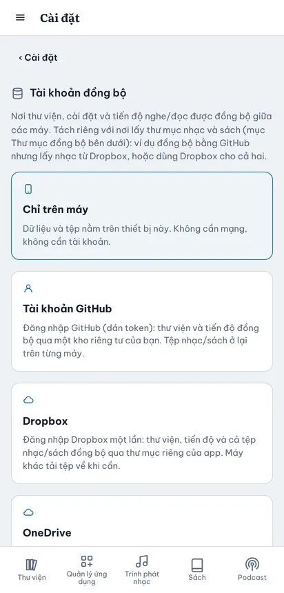
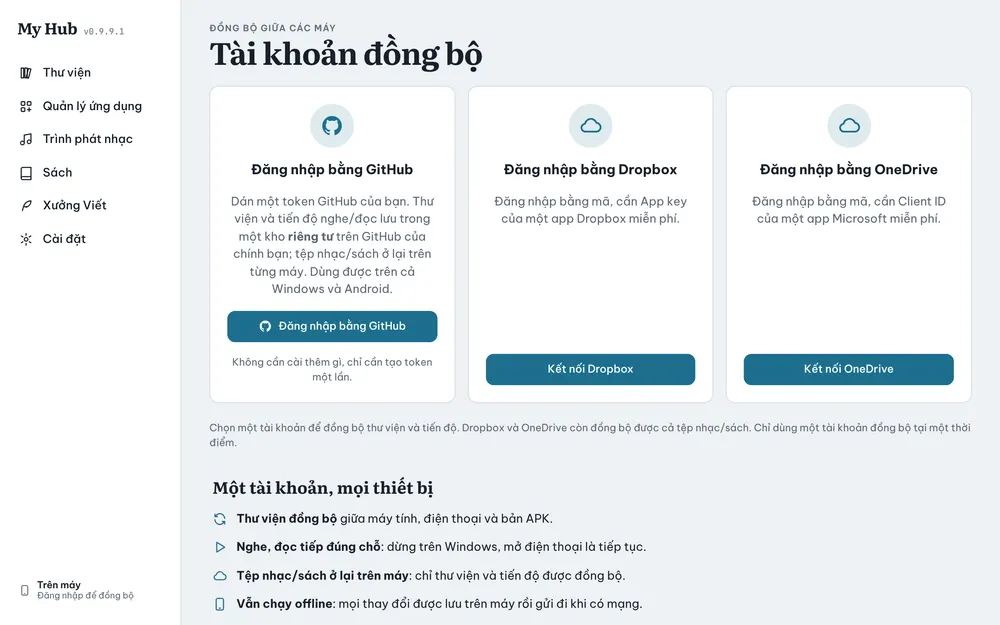
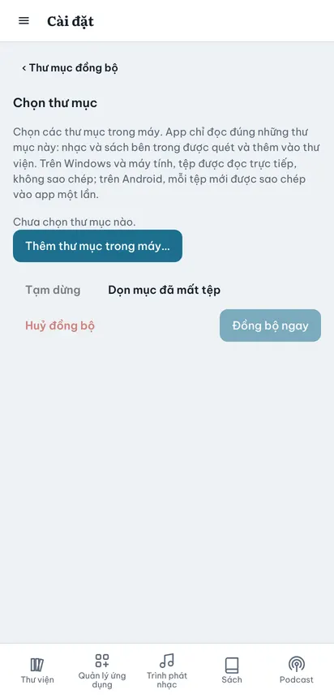

# Đồng bộ: tài khoản và thư mục

Trang **Cài đặt** là một danh sách mục, bấm mục nào thì mở trang riêng của mục đó. Hai mục liên quan tới đồng bộ là hai lựa chọn riêng, không phụ thuộc nhau:

- **Tài khoản đồng bộ**: nơi thư viện, cài đặt và tiến độ nghe/đọc/viết đi giữa các máy.
- **Thư mục đồng bộ**: nơi app lấy nhạc và sách (thư mục trong máy, hoặc thư mục trên Dropbox / OneDrive).

Ví dụ hay dùng: đồng bộ bằng **GitHub** nhưng lấy nhạc từ **Dropbox**; hoặc dùng **Dropbox** cho cả hai.

## Tài khoản đồng bộ

### Bốn chế độ

| Chế độ | Đồng bộ gì | Tệp nhạc/sách |
|---|---|---|
| **Chỉ trên máy** | Không đồng bộ, không cần mạng, không cần tài khoản | Ở lại máy này |
| **Tài khoản GitHub** | Thư viện, cài đặt, tiến độ, qua kho riêng tư `my-hub-data` của bạn | Ở lại từng máy, không tải lên |
| **Dropbox** | Thư viện, tiến độ và cả tệp, trong thư mục riêng của app | Tự tải lên; máy khác tải về khi mở |
| **OneDrive** | Như Dropbox, trong `Apps/…` | Như Dropbox |
| **Google Drive** | Thư viện và tiến độ nằm trong thư mục ẩn của app trên Drive | Chỉ đọc, phát thẳng từ Drive; không sao chép |

Cách bật: **Cài đặt → Tài khoản đồng bộ** (mở trang riêng), bấm vào một ô.

### Đăng nhập GitHub

1. Bấm ô **Tài khoản GitHub**, hoặc vào trang **Tài khoản → Đăng nhập bằng GitHub**.
2. App mở trang tạo token của GitHub. Giữ ô `repo` đã tích, bấm **Generate token**.
3. Sao chép chuỗi bắt đầu bằng `ghp_…`, dán vào app.
4. App tự tạo kho riêng tư `my-hub-data` và đồng bộ lần đầu.
5. Trên máy khác, làm lại đúng các bước trên với **cùng tài khoản GitHub**.

### Kết nối Dropbox

1. Bấm ô **Dropbox**. Hộp **Kết nối Dropbox** mở ra.
2. Nếu app hỏi **App key**: dán App key của app Dropbox của bạn (tạo một lần ở https://www.dropbox.com/developers/apps, loại *Scoped access* + *App folder*, bật quyền `files.content.read` và `files.content.write`).
3. Bấm **Kết nối**. Trang Dropbox mở ra, bấm **Allow**.
4. Dropbox hiện một mã. Sao chép, dán vào ô **Mã Dropbox** trong app.

### Kết nối OneDrive

1. Bấm ô **OneDrive**. Hộp **Kết nối OneDrive** mở ra.
2. Nếu app hỏi **Client ID**: dán Application (client) ID của app Microsoft Entra của bạn.
3. Bấm **Kết nối**, đăng nhập Microsoft và cho phép.
4. Trình duyệt chuyển tới một **trang trắng**. Sao chép cả địa chỉ trên thanh địa chỉ, dán vào ô **Địa chỉ trang trắng (hoặc mã)**.

### Khi cả máy và tài khoản đều đã có dữ liệu

App hỏi **Máy này đã có dữ liệu**:

- **Gộp** (nên chọn): giữ cả hai, bản sửa mới hơn thắng.
- **Dùng dữ liệu của …**: bỏ dữ liệu trên máy, lấy toàn bộ từ tài khoản.
- **Để sau**: chưa đồng bộ.

### Khi nào app đồng bộ

- Khi mở app, khi có mạng trở lại, khoảng 8 giây sau mỗi thay đổi, và mỗi 2 phút khi app đang mở.
- Tiến độ nghe/đọc đi riêng, nhanh hơn: vài giây sau mỗi lần dừng. Mở máy khác là nghe/đọc tiếp đúng chỗ.
- Bảng bên dưới các ô có: **Đồng bộ ngay**, **Đổi tài khoản**, **Ngừng dùng … (về Local)**, **Xoá dữ liệu trên …**.

## Thư mục đồng bộ (nhạc và sách)

1. **Cài đặt → Thư mục đồng bộ**, chọn nơi lấy: **Trong máy**, **Dropbox** hoặc **OneDrive**. Chọn một ổ chưa kết nối thì app mở hộp đăng nhập ổ đó; tài khoản đồng bộ không đổi.
2. Bấm **Chọn thư mục, đồng bộ, tạm dừng, huỷ**.
3. Với ổ đám mây: tích một hoặc nhiều thư mục trong cây thư mục. Với **Trong máy**: bấm **Thêm thư mục trong máy…**.
4. Mỗi thư mục có thể chọn app nhận tệp: **Trình phát nhạc**, **Sách**, hoặc cả hai.
5. Bấm **Đồng bộ ngay**. Thẻ tiến trình hiện đang quét hay đang nhập, bao nhiêu tệp, bao nhiêu phần trăm.
6. Lần sau chỉ tệp mới được nhập. Tệp mới trong thư mục cũng tự vào thư viện mỗi lần đồng bộ.

### Tệp được xử lý thế nào

| Nguồn | Có sao chép vào app không |
|---|---|
| Dropbox / OneDrive | Không. Nhạc phát thẳng từ ổ; sách được tải về khi mở |
| Trong máy, trên Windows | Không. Đọc thẳng từ ổ cứng |
| Trong máy, trên Android | Có, mỗi tệp mới được sao chép vào app một lần |

Có thể chọn nhiều nơi cùng lúc: ví dụ **Trong máy** cho nhạc và **Google Drive** cho sách.

Thư mục đồng bộ chỉ đi **một chiều**: app đọc tệp từ thư mục, không bao giờ tải tệp đó lên tài khoản đồng bộ. Ví dụ nhạc lấy từ Dropbox sẽ không bị chép thêm một bản lên OneDrive.

## Tạm dừng, huỷ, dọn

- **Tạm dừng**: dừng lượt đang chạy, giữ nguyên những gì đã nhập. App không tự đồng bộ thư mục nữa cho tới khi bạn bấm **Đồng bộ ngay**, lúc đó tiếp tục từ chỗ đã dừng.
- **Huỷ đồng bộ**: dừng và **xoá khỏi thư viện** mọi bài nhạc, sách đã nhập từ các thư mục đã chọn, đặt lại tiến trình từ đầu. Tệp gốc trên ổ hoặc trong máy không bị đụng tới. Danh sách thư mục vẫn giữ, bấm **Đồng bộ ngay** để làm lại.
- **Dọn mục đã mất tệp**: xoá khỏi thư viện những mục mà tệp gốc đã bị xoá.
- Mọi tác vụ dài (đồng bộ, tải lên, tải về) cũng hiện ở **khay tác vụ** góc màn hình, có nút huỷ từng tác vụ và tốc độ, thời gian còn lại.

## Mẹo

- Token và mã kết nối chỉ nằm trên từng máy, không vào bản sao lưu JSON. Máy mới phải đăng nhập lại.
- Dùng GitHub mà muốn có nhạc trên điện thoại: chọn **Thư mục đồng bộ** là Dropbox hoặc OneDrive.
- Bấm **Yêu cầu lưu trữ bền vững** trong Cài đặt để trình duyệt không tự xoá dữ liệu khi máy đầy.
