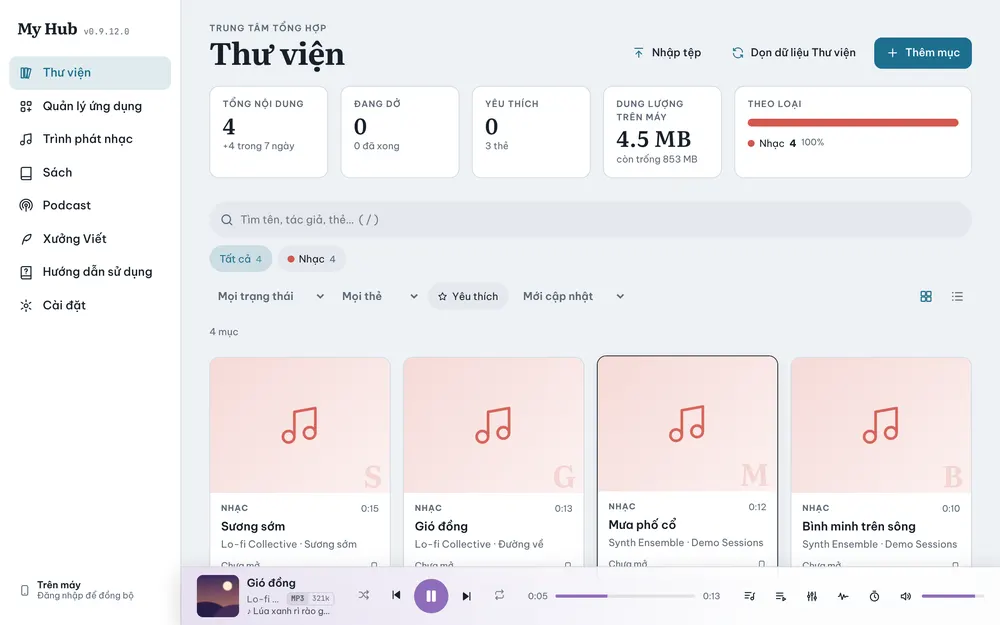

# Thư viện

**Thư viện** là trang chủ của My Hub: gom mọi nội dung từ các app (nhạc, sách, fanfic…) vào một chỗ để tìm, lọc và mở nhanh.

## Các phần trên trang

- **Thẻ thống kê**: Tổng nội dung, Đang dở, Yêu thích, Dung lượng trên máy, Theo loại.
- **Ô tìm kiếm**: tìm theo tên, tác giả, thẻ. Phím tắt `/` trên máy tính.
- **Chip loại**: Tất cả, Nhạc, Sách, Fanfic… bấm để lọc.
- **Bộ lọc**: Mọi trạng thái, Mọi thẻ, Yêu thích, sắp xếp (Mới cập nhật…), chuyển lưới / danh sách.
- **Tiếp tục**: những mục đang dở, xếp theo lần dừng gần nhất trên mọi máy, ghi rõ dừng ở máy nào.

Lựa chọn lọc được nhớ lại khi bạn quay lại, kể cả sau khi khởi động lại app.

## Thêm nội dung

- **Thêm mục**: tạo một mục mới bằng tay.
- **Nhập tệp**: chọn tệp từ máy; app tự giao cho đúng app (nhạc cho **Trình phát nhạc**, sách cho **Sách**).
- Hoặc thêm trong từng app, hoặc dùng **Thư mục đồng bộ** (xem [Đồng bộ](20-dong-bo.md)).

## Ngăn chi tiết

Bấm một mục để mở ngăn chi tiết: thông tin, thẻ, yêu thích, và các khối của app khác. Ví dụ với sách có khối **Nhạc nền** của **Trình phát nhạc** để gắn danh sách phát tự phát khi đọc; với fanfic có fandom, xếp hạng và nút sửa trong **Xưởng Viết**.

## Đặt lại tiến trình

Trong ngăn chi tiết của một mục đang dở, nút **Đặt lại tiến trình** đưa mục đó về lại từ đầu (chưa đọc, chưa nghe). Muốn đặt lại cả một app hoặc tất cả, dùng **Cài đặt → Đặt lại tiến trình** (xem [Cài đặt](36-cai-dat.md)).

## Dọn dữ liệu Thư viện

Nút **Dọn dữ liệu Thư viện** xoá các mục hỏng hoặc đã mất tệp. App luôn hỏi lại trước khi xoá.
