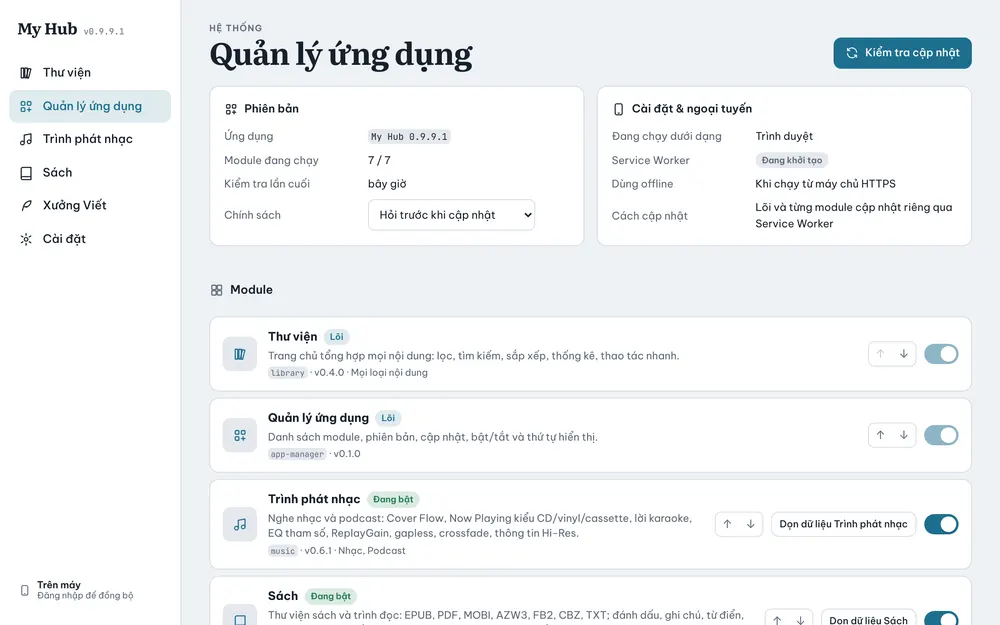

# Quản lý ứng dụng

Nơi xem phiên bản, kiểm tra cập nhật, bật/tắt và sắp xếp các app trong My Hub.

## Phiên bản và cập nhật

- **Phiên bản**: bản My Hub đang chạy, số module đang chạy, lần kiểm tra cuối.
- **Kiểm tra cập nhật**: hỏi GitHub có bản mới không. Có thì hiện danh sách kèm ghi chú thay đổi và nút **Cập nhật** / **Cập nhật tất cả**.
- **Chính sách**: chọn **Hỏi trước khi cập nhật** hoặc tự cập nhật.
- Trên **Windows**, **Cập nhật** tải bản cài mới ở nền (xem [Windows](11-windows.md)). Trên **Android**, app nhắc mở Obtainium (xem [Android](10-android.md)).

## Cài đặt & ngoại tuyến

Cho biết app đang chạy dưới dạng nào (Windows, Android hay trình duyệt), trạng thái chạy offline và cách cập nhật tương ứng.

## Module

Mỗi app là một thẻ:

- Nhãn **Lõi** (Thư viện, Quản lý ứng dụng): không tắt được.
- Nhãn **Đang bật**: công tắc bên phải để tắt; app tắt sẽ ẩn khỏi thanh bên và thanh dưới, dữ liệu vẫn giữ.
- Mũi tên **lên / xuống**: đổi thứ tự trên thanh bên và thanh dưới.
- **Dọn dữ liệu …** (ví dụ **Dọn dữ liệu Trình phát nhạc**): xoá dữ liệu của riêng app đó, có hỏi lại.

Khi có app mới (ví dụ video, ảnh, ghi chú), nó cũng hiện ở đây và trong mục lục hướng dẫn này.
