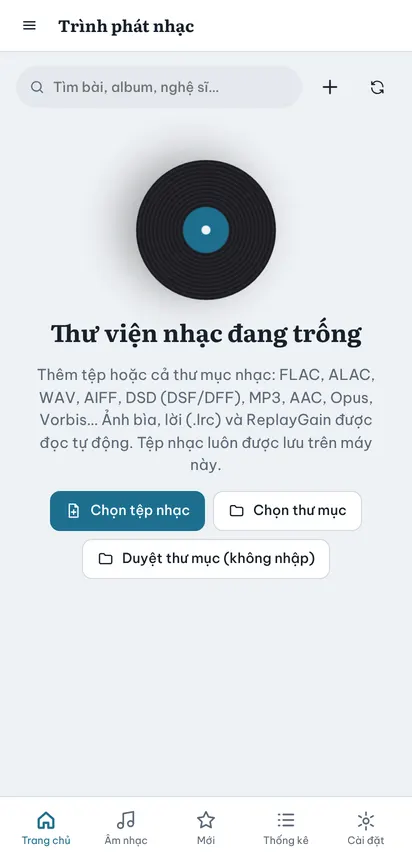
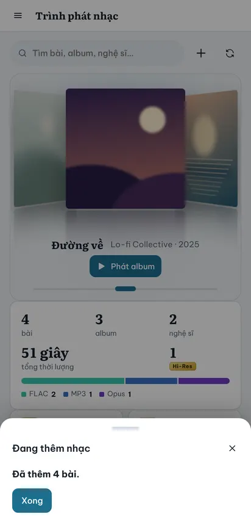
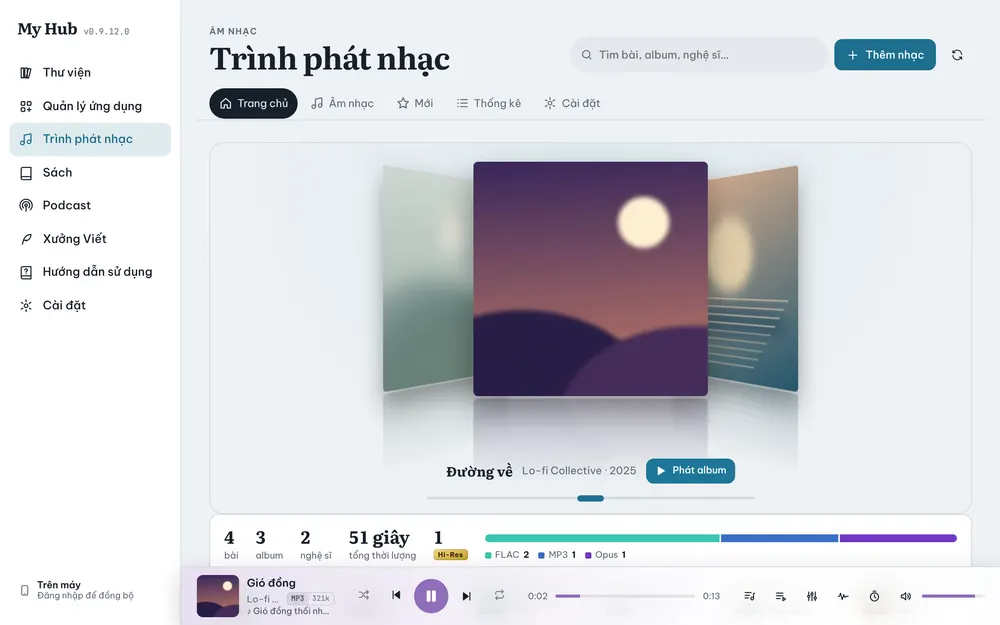

# Trình phát nhạc

Nghe nhạc và podcast với thông tin chất lượng chi tiết (Hi-Res, lossless), lời karaoke, EQ và đồng bộ chỗ đang nghe giữa các máy.

## Thêm nhạc

Lần đầu mở, thư viện nhạc trống và có ba nút:

- **Chọn tệp nhạc**: chọn một hoặc nhiều tệp.
- **Chọn thư mục**: nhập cả thư mục.
- **Duyệt thư mục (không nhập)**: nghe thẳng từ thư mục trên máy mà không thêm vào thư viện (máy tính).

Khi nhập, bảng **Đang thêm nhạc** hiện tiến trình, xong thì báo số bài đã thêm. Ảnh bìa, lời `.lrc` cùng tên và ReplayGain được đọc tự động.

Định dạng: FLAC, ALAC, WAV, AIFF, DSD (DSF/DFF), MP3, AAC/M4A, Opus, Vorbis. WavPack, APE vẫn nhập được nhưng chưa phát.

> Muốn tự cập nhật nhạc từ một thư mục (trong máy, Dropbox, OneDrive), dùng **Cài đặt → Thư mục đồng bộ** (xem [Đồng bộ](20-dong-bo.md)).

## Trang chủ nhạc

- **Cover Flow** các album: vuốt ngang, bấm **Phát album**.
- Thống kê nhanh: số bài, album, nghệ sĩ, tổng thời lượng, số bài Hi-Res, tỷ lệ định dạng.
- Lối tắt: Yêu thích, Hi-Res, Nghe nhiều nhất, Mới thêm, Chưa nghe.
- Thanh mục: **Trang chủ**, **Âm nhạc** (bài hát, album, nghệ sĩ, thể loại, thư mục, danh sách phát), **Mới**, **Thống kê**, **Cài đặt**. Trên máy tính, các mục là một hàng nút ở trên cùng; **Âm nhạc** mở lại đúng mục bạn xem lần trước (Album, Nghệ sĩ…).

## Thanh phát và Now Playing

- Thanh phát ở đáy: bài đang phát, định dạng (ví dụ `MP3 321k`), ngẫu nhiên, lùi, phát/dừng, tới, lặp, thanh thời gian.
- Các nút bên phải: **Lời**, **Hàng chờ**, **EQ**, đường tín hiệu, **hẹn giờ ngủ**, âm lượng.
- Bấm vào bìa (hoặc vuốt lên trên điện thoại) để mở **Now Playing** toàn màn hình: bìa phẳng / CD / vinyl / cassette, lời karaoke chạy theo từng chữ, video nền sau lời.

## Lời bài hát

- **Chọn mô hình**: mỗi việc có mục riêng. **Mô hình tạo lời** dùng khi tạo lời mới; **Mô hình đồng bộ từng chữ** canh thời gian từng chữ. Các lựa chọn có **Base** (nhẹ, nhanh), **Small**, **Medium**, **Large v3** và **Large v3 Turbo** (chính xác nhất, nặng nhất). Mô hình lớn cần nhiều bộ nhớ: trên điện thoại app sẽ hỏi xác nhận trước khi dùng.
- Đồng bộ từng chữ bằng Base sẽ có thông báo kèm gợi ý chọn mô hình lớn hơn để chính xác hơn.
- Chế độ **Tạo lời tự động** trên điện thoại chỉ dùng mô hình nhỏ và bài ngắn hơn 10 phút, để không làm app bị hệ điều hành đóng.
- Lời dịch có hai chế độ: **Nhanh** và **Chính xác**.

- Lời `.lrc` cùng tên tệp được nhập tự động.
- Bài chưa có lời: bật **Tự tạo lời khi không có (AI)**; app nghe bài hát và tạo lời ngay trên máy (lần đầu tải mô hình AI, cần mạng).
- Lời đã có nhưng chỉ theo dòng: **Tự đồng bộ từng chữ (AI)** canh thời gian cho từng chữ để chạy karaoke **Đồng bộ từng chữ**.
- Trong tab **Lời**: chạm một dòng để tua tới đó, chỉnh cỡ chữ, sửa lời, chấm nhịp lại; có **Bản dịch** và **Tìm trực tuyến**.

## Nghe liên tục

- **Auto DJ** (**Cài đặt** của Trình phát nhạc): hết hàng chờ thì tự thêm bài tương tự (cùng nghệ sĩ, thể loại, thời kỳ).
- **Hàng chờ tạm**: phát nhanh một nhóm bài mà không xoá hàng chờ đang có; xong thì quay lại hàng chờ cũ.
- **Crossfade**, **Crossfade thông minh**, **Gapless**: chuyển bài mượt hoặc liền mạch.
- **Tài khoản ListenBrainz**: dán token để ghi lại lịch sử nghe (scrobble).

## Phát ra đâu

| Cách | Ở đâu | Ghi chú |
|---|---|---|
| **Thiết bị phát** | Cài đặt của Trình phát nhạc | Chọn loa, tai nghe, DAC (máy tính) |
| **WASAPI Exclusive (bit-perfect, Windows)** | Cài đặt → **Engine** | Gửi thẳng tín hiệu gốc tới DAC, không qua bộ trộn của Windows |
| **USB DAC (Android)** | Cài đặt của Trình phát nhạc | Xuất thẳng ra DAC cắm cổng USB |
| Loa / TV trong mạng (DLNA / UPnP, Chromecast) | Nút phát tới thiết bị ở Now Playing | Điện thoại thành điều khiển từ xa |
| Android Auto, thông báo, màn hình khoá | Tự có trên app Android | Nhạc vẫn phát khi tắt màn hình |

## Widget trên màn hình chính (Android)

Giữ một chỗ trống trên màn hình chính → **Widget** → **My Hub** → chọn widget **Trình phát nhạc**. Widget hiện bài đang phát, nút tua, phát và tạm dừng. Kéo góc widget để đổi kích thước: 4×2 có đầy đủ thông tin, 4×1 gọn hơn.

## Gắn nhạc với sách và fanfic

Trong ngăn chi tiết của một cuốn sách hoặc fanfic, khối **Nhạc nền** cho phép gắn bài, album, nghệ sĩ hoặc danh sách phát. Mở sách là nhạc tự phát.

## Nghe tiếp trên máy khác

Khi bật một **Tài khoản đồng bộ**, chỗ đang nghe và hàng chờ được đẩy lên vài giây sau khi dừng. Mở máy khác là nghe tiếp đúng chỗ.
