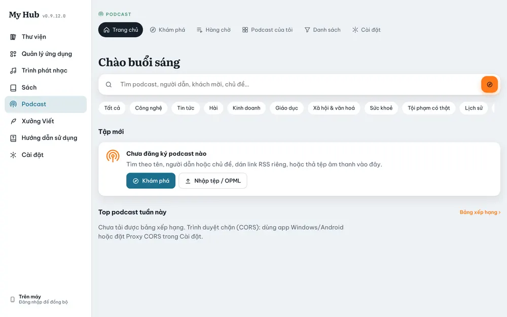
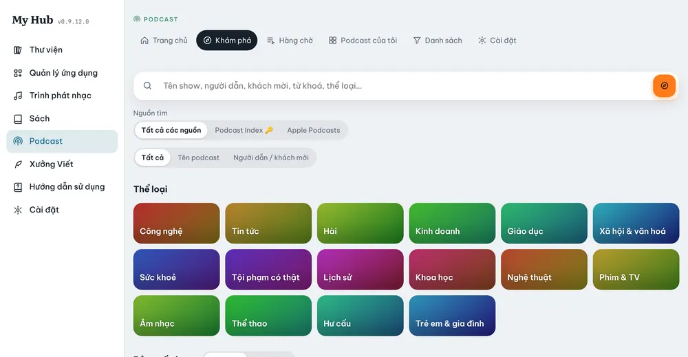

# Podcast

Tìm, đăng ký và nghe podcast. App lưu chỗ đang nghe, tải tập về để nghe khi không có mạng, và đồng bộ sang máy khác.

## Các mục

**Trang chủ**, **Khám phá**, **Hàng chờ**, **Podcast của tôi**, **Danh sách**, **Cài đặt**.

- **Trang chủ**: ô tìm nhanh, thể loại, **Tập mới** của các podcast đã đăng ký, **Top podcast tuần này**; khi đã nghe hoặc tải thì có thêm **Nghe tiếp** và **Đã tải về máy**. Chưa đăng ký gì thì có nút **Khám phá** và **Nhập tệp / OPML**.
- **Khám phá**: tìm podcast online, **Thể loại**, **Bảng xếp hạng** (Top Apple, Thịnh hành), **Gợi ý cho bạn**.
- **Hàng chờ**: các tập sẽ phát tiếp; kéo thả để đổi thứ tự.
- **Podcast của tôi**: mọi podcast đã đăng ký.
- **Danh sách**: danh sách riêng và **Bộ lọc thông minh** (ví dụ các tập chưa nghe dưới 30 phút).

## Tìm và đăng ký

1. Vào **Khám phá**, gõ tên podcast vào ô tìm.
2. Chọn **Nguồn tìm**: **Tất cả các nguồn**, **Podcast Index** hoặc **Apple Podcasts**; có thể tìm theo **Tên podcast** hoặc **Người dẫn / khách mời**. Mỗi kết quả ghi rõ nguồn.
3. Bấm vào podcast để xem trang của nó, rồi bấm **Đăng ký**.
4. Có link RSS riêng (ví dụ podcast trả phí): dùng **Thêm bằng link RSS**.

> Podcast Index cần một khoá miễn phí. Điền khoá và secret ở **Podcast → Cài đặt**. Không có khoá thì vẫn tìm được qua Apple.

### Một podcast có nhiều nguồn

Nếu một podcast có ở nhiều nơi, trang podcast có mục **Nguồn của podcast này**: so sánh số tập, độ mới, chất lượng âm thanh, có chương hay bản chép lời không. Bấm **Theo nguồn này** để đổi nguồn theo dõi.

## Nghe

- Bấm một tập để phát. Mini player hiện ở đáy; chạm vào để mở màn hình **Đang phát**.
- **Tốc độ phát** từ 0,5× tới 3×, giọng không bị méo.
- **Bỏ khoảng lặng** (Skip silence) và **Voice Boost** cho giọng nói rõ hơn.
- **Hẹn giờ ngủ**: theo phút, hết tập, hoặc hết chương.
- **Chương**, **Dấu trang**, **Ghi chú tập** và **Bản chép lời** (lấy từ feed; tập không có thì app tạo bằng AI).
- Trên Android: điều khiển ở thông báo, màn hình khoá và tai nghe Bluetooth.
- **Trình phát nhạc** và **Podcast** tự dừng nhau: bật cái này thì cái kia tạm dừng.

## Tải về và nhập

- Bấm **Tải về** ở một tập để nghe khi không có mạng. Tệp tải về chỉ nằm trên máy đó, không đồng bộ.
- **Nhập tệp âm thanh**: thêm tệp audio hoặc sách nói có sẵn trên máy.
- **Nhập OPML**: chuyển danh sách đăng ký từ app podcast khác sang.

## Thao tác nhanh

Nhấn giữ (điện thoại) hoặc chuột phải (máy tính) vào một tập hay một podcast để mở menu: thêm vào hàng chờ, đánh dấu đã nghe, gắn sao, tải về, huỷ đăng ký.

## Nghe khi đọc sách

Trong trình đọc của **Sách**, nút **Nghe khi đọc** cho chọn **Trình phát nhạc** hoặc **Podcast**. Mini player nổi gọn phía trên trang sách.
