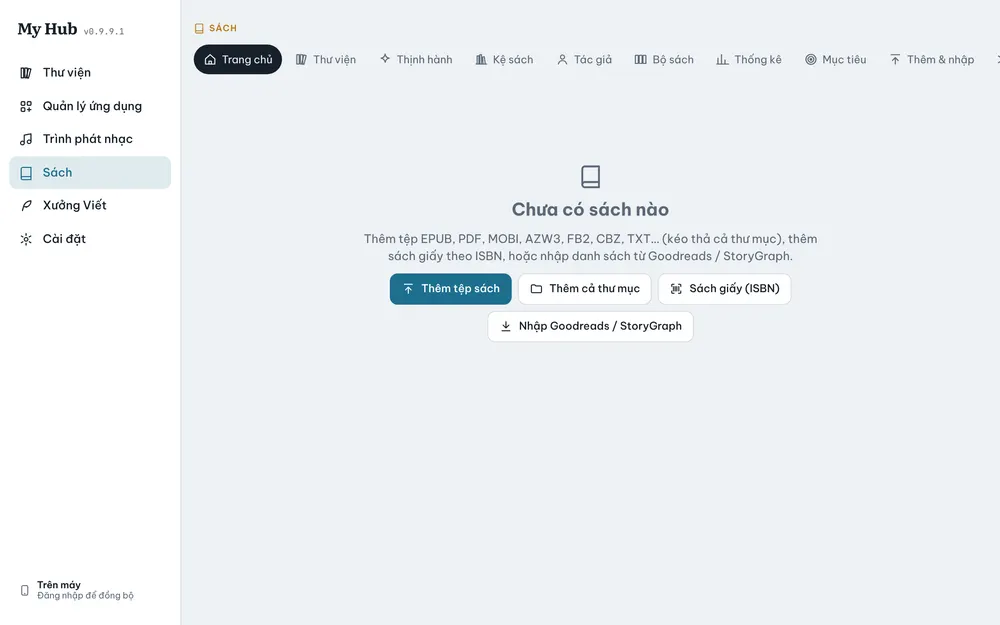
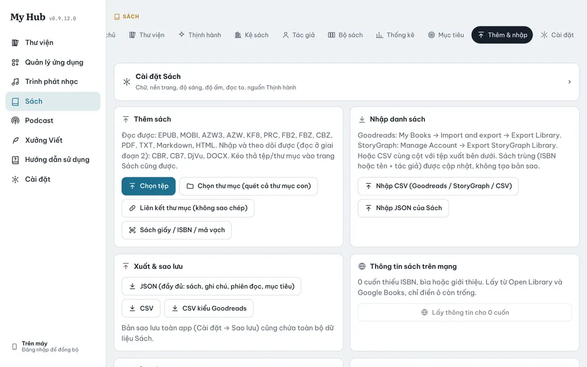

# Sách

Quản lý thư viện sách, đọc sách và theo dõi việc đọc.

## Các mục

**Trang chủ**, **Thư viện**, **Thịnh hành**, **Kệ sách**, **Tác giả**, **Bộ sách**, **Thống kê**, **Mục tiêu**, **Thêm & nhập**, **Cài đặt**. Trên điện thoại, thanh dưới có năm mục chính và **Thêm** cho phần còn lại.

## Thêm sách

- **Thêm tệp sách**: chọn một hoặc nhiều tệp.
- **Thêm cả thư mục**: nhập mọi sách trong thư mục (có thể kéo thả cả thư mục vào cửa sổ).
- **Sách giấy (ISBN)**: nhập ISBN hoặc tên sách để thêm sách in, chỉ để theo dõi.
- **Nhập Goodreads / StoryGraph**: nhập danh sách sách đã đọc từ tệp xuất của hai trang này.
- Hoặc dùng **Thư mục đồng bộ** để tự nhập sách từ máy, Dropbox, OneDrive (xem [Đồng bộ](20-dong-bo.md)).

| Đọc được | Nhập và theo dõi, chưa đọc được |
|---|---|
| EPUB, MOBI, AZW/AZW3, FB2, CBZ, PDF, TXT, MD, HTML | CBR, CB7, DjVu, DOCX |

## Đọc

1. Bấm một cuốn để mở trang sách, rồi bấm đọc.
2. Chạm giữa màn hình để hiện thanh công cụ: mục lục, cỡ chữ, phông, giao diện, chế độ cuộn hay lật trang.
3. Chọn chữ để **đánh dấu**, **gạch chân**, **ghi chú**; thêm **dấu trang** ở góc.
4. PDF có ba chế độ: cuộn, theo trang (hai trang trên màn hình rộng), dàn lại chữ.
5. Vị trí đọc tự lưu và đồng bộ, mở máy khác là đọc tiếp đúng trang.

Nếu sách có **Nhạc nền** gắn sẵn, **Trình phát nhạc** tự phát khi bạn mở sách.

### Nghe khi đọc

Trong trình đọc, bấm **Nghe khi đọc** rồi chọn **Trình phát nhạc** hoặc **Podcast**. Một mini player nhỏ nổi phía trên trang sách; các bảng của Trình phát nhạc (lời, hàng chờ, EQ, hẹn giờ) mở ngay trên trình đọc mà không phải rời sách.

### Đọc lại từ đầu

Ở trang sách, **Đặt lại tiến trình** đưa vị trí đọc về đầu sách (trên mọi máy).

## Theo dõi việc đọc

- **Trạng thái**: muốn đọc, đang đọc, đã đọc, bỏ dở, tạm dừng.
- Chấm điểm nửa sao, nhận xét, ghi chú riêng, tâm trạng, nhịp truyện, cảnh báo nội dung.
- **Kệ sách**: kệ thường, hoặc kệ thông minh tự lọc theo điều kiện.
- **Thống kê** và **Mục tiêu**: số sách, số trang, thời gian đọc, tốc độ đọc, mục tiêu theo năm/tháng.

## Tìm kiếm nâng cao

| Gõ | Tìm |
|---|---|
| `author:Nguyễn` | Sách của tác giả có "Nguyễn" |
| `tag:fantasy` | Sách có thẻ fantasy |
| `rating:>=4` | Từ 4 sao trở lên |
| `status:reading` | Đang đọc |
| `-tag:horror` | Bỏ sách có thẻ horror |

## Đồng bộ tệp sách

- **GitHub**: thông tin, tiến độ, ghi chú đồng bộ; tệp sách ở lại từng máy. Thêm cùng tệp trên máy kia thì app tự ghép theo tên và kích thước.
- **Dropbox / OneDrive**: tệp cũng được đồng bộ, máy khác tải về khi mở.
