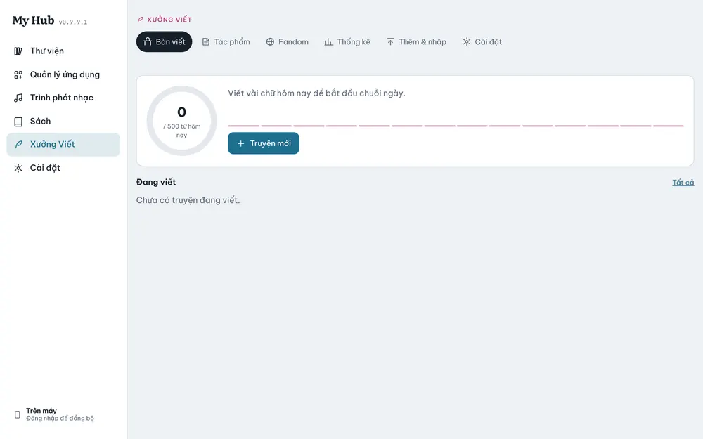
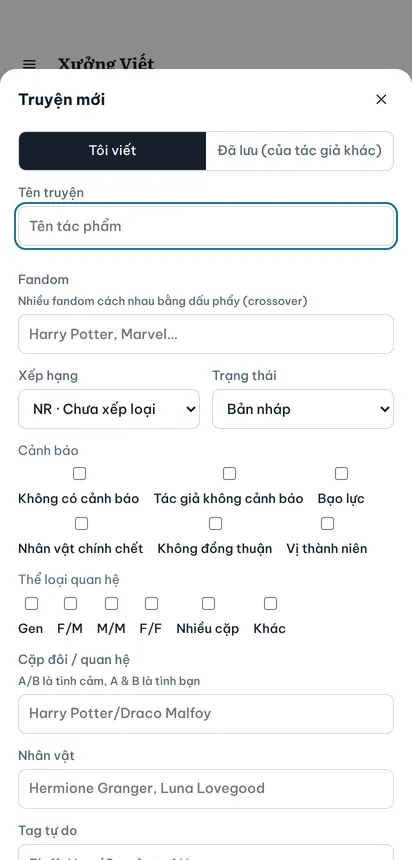
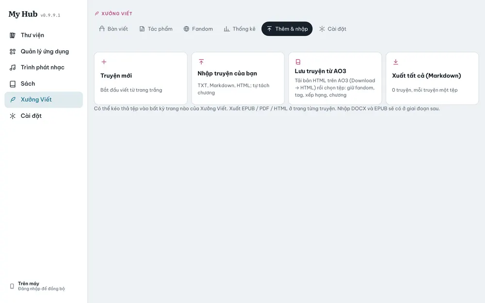

# Xưởng Viết

Nơi viết, nhập và quản lý fanfic. Đọc thì dùng **Sách**.

Các mục: **Bàn viết**, **Tác phẩm**, **Fandom**, **Thống kê**, **Thêm & nhập**, **Cài đặt**.

## Bàn viết

- Vòng tròn **số chữ hôm nay** so với mục tiêu (mặc định 500 từ) và thanh chuỗi ngày viết liên tục.
- **Đang viết**: các truyện đang dở, bấm **Viết tiếp** để vào đúng chương.
- **Truyện mới**: bắt đầu một truyện.
- Đặt mục tiêu bằng **Đặt mục tiêu** (theo ngày, hoặc tổng số chữ kèm hạn chót).

## Tạo truyện mới

1. Bấm **Truyện mới** (ở Bàn viết hoặc **Thêm & nhập**).
2. Chọn **Tôi viết** hoặc **Đã lưu (của tác giả khác)**.
3. Điền **Tên truyện**, **Fandom** (nhiều fandom cách nhau bằng dấu phẩy cho crossover).
4. Chọn **Xếp hạng** (G, T, M, E, NR như AO3), **Trạng thái** (bản nháp, đang viết, hoàn thành…).
5. Tích **Cảnh báo** và **Thể loại quan hệ** (Gen, F/M, M/M, F/F…).
6. Điền **Cặp đôi / quan hệ** (`A/B` là tình cảm, `A & B` là tình bạn), **Nhân vật**, **Tag tự do**, tóm tắt.
7. Bấm **Lưu**.

## Nhập truyện

Ở **Thêm & nhập**:

- **Nhập truyện của bạn**: TXT, Markdown, HTML; app tự tách chương.
- **Lưu truyện từ AO3**: trên AO3 bấm **Download → HTML**, rồi chọn tệp đó. Fandom, tag, xếp hạng, chương được giữ.
- **Xuất tất cả (Markdown)**: mỗi truyện một tệp.
- Có thể kéo thả tệp vào bất kỳ trang nào của Xưởng Viết.

## Trình viết

- Bên trái: danh sách **Chương và cảnh**. Kéo thả để sắp xếp, **Thêm chương sau**, **Thêm cảnh**.
- Viết bằng Markdown; nút **Đậm**, **Nghiêng**, **Trích dẫn**, **Chuyển cảnh**, **Xem trước**. App tự lưu.
- **Chế độ tập trung**: ẩn mọi thứ trừ văn bản; chế độ máy chữ giữ dòng đang gõ ở giữa màn hình.
- **Chụp phiên bản**: lưu một bản của chương. App tự chụp trước khi bạn xoá nhiều chữ. Khôi phục trong danh sách phiên bản.
- Ghi chú nhân vật, cốt truyện, tư liệu, thế giới, ý tưởng nằm cạnh truyện.
- Galaxy Z Flip ở **Flex Mode**: chữ ở nửa trên, công cụ ở nửa dưới. Màn hình ngoài hiện số chữ hôm nay và **Viết tiếp**.

## Đọc trong Sách

1. Ở trang truyện, bấm **Xuất bản sang Sách**. Các chương được chép sang Sách.
2. Bấm **Đọc trong Sách** để đọc như một cuốn sách. Tiến độ đọc hiện cả ở Xưởng Viết.
3. Trong trình đọc có nút **Sửa trong Xưởng Viết** để quay lại đúng chương.
4. Sửa xong thì bấm **Xuất bản** lại để Sách có bản mới.
5. **Gỡ khỏi Sách** chỉ gỡ bản đọc, truyện vẫn còn trong Xưởng Viết.

## Xuất tệp

Ở trang từng truyện: **Xuất EPUB**, **Xuất HTML**, **Xuất Markdown**, **Xuất TXT**.

## Fandom và sách gốc

Ở **Fandom**, liên kết một fandom với sách gốc trong Sách. Mở sách gốc sẽ thấy các fanfic của fandom đó và nút **Viết fanfic cho truyện này**.

Chưa có (giai đoạn sau): nhập DOCX/EPUB, bảng cốt truyện, đăng lên AO3.
