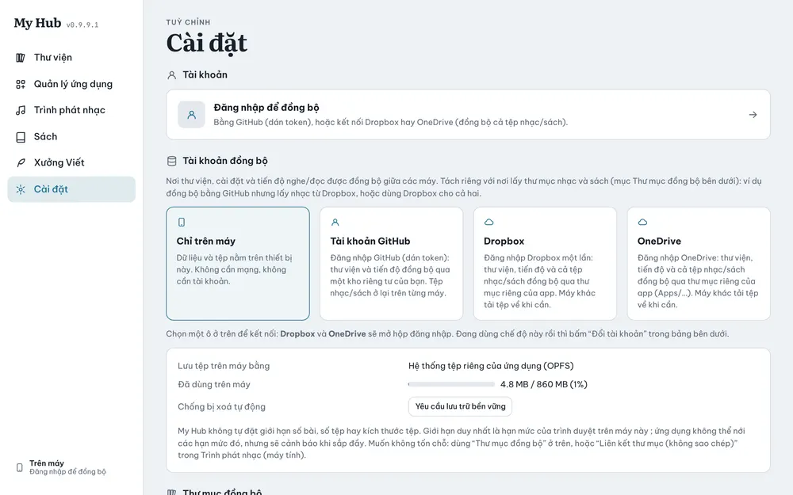

# Cài đặt

## Các phần

| Phần | Làm gì |
|---|---|
| **Tài khoản** | Đăng nhập để đồng bộ, xem máy đang dùng |
| **Tài khoản đồng bộ** | Chọn Chỉ trên máy / GitHub / Dropbox / OneDrive (xem [Đồng bộ](20-dong-bo.md)) |
| **Thư mục đồng bộ** | Chọn nơi lấy nhạc và sách, tạm dừng, huỷ |
| **Thiết bị** | Danh sách máy dùng chung, đổi tên máy, đăng xuất từ xa |
| **Giao diện** | Chủ đề màu, skin, ngôn ngữ (Tiếng Việt / English) |
| **Tham số** | Tuỳ chọn chung và của từng app (Sách & trình đọc, Trình phát nhạc…) |
| **Sao lưu dữ liệu** | Xuất toàn bộ thư viện ra tệp JSON, hoặc nhập lại từ tệp đó |

## Sao lưu và khôi phục

1. **Cài đặt → Sao lưu dữ liệu**, bấm xuất. App lưu một tệp JSON.
2. Trên máy khác (hoặc sau khi cài lại), bấm nhập và chọn tệp đó.

Tệp JSON chứa thư viện, tiến độ, ghi chú, truyện; không chứa tệp nhạc/sách và không chứa token đăng nhập.

## Chống bị xoá dữ liệu

Bấm **Yêu cầu lưu trữ bền vững** để trình duyệt không tự xoá dữ liệu khi máy sắp đầy. Thanh **Đã dùng trên máy** cho biết dung lượng còn lại.
